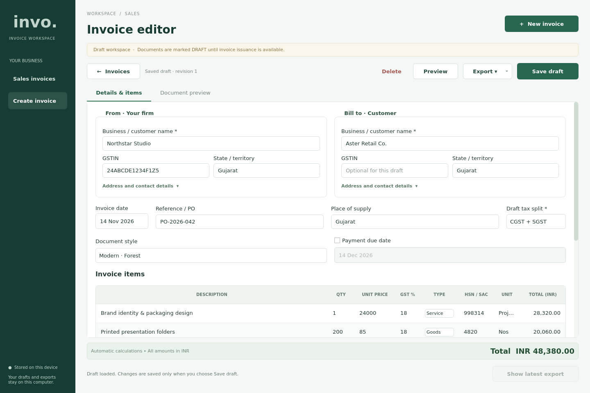

# Invoice Generator

An offline desktop application for an Indian firm's sales invoices, built with
**PySide6, a separate Python backend, and SQLite**.

**Status: an expanded draft workspace.** The application now has a separate sales
list and invoice editor, automatic totals, PDF preview, Word export and a date-range
review package. Numbered GST issuance is still a later milestone. All documents
remain clearly marked **DRAFT**.

## What works now

- A styled desktop workspace with search, date filters, draft counts and totals.
- Separate invoice editor with unsaved-change protection and keyboard shortcuts.
- Firm/customer addresses, GSTIN, state, email and phone captured with each draft.
- Goods/services, HSN/SAC, units, references, optional due dates, notes and payment terms.
- Automatic Decimal totals, per-line totals and INR amount in Indian-numbering words.
- CGST + SGST or IGST chosen explicitly by the operator; rates are draft inputs.
- Save, reopen, update and soft-delete drafts with revision checks and audit history.
- Actual PDF preview without saving, plus PDF and editable Word (.docx) export.
- Two built-in document colour styles: Modern and Classic.
- One-click date-range ZIP with all matching saved drafts: PDFs, Word copies,
  invoice and line CSV registers, and a captured-revision manifest.
- Separate backend that runs without Qt; five enforced dependency boundaries.



## Windows setup

Install **64-bit Python 3.12** and Git. In PowerShell, clone the repository:

```powershell
git clone https://github.com/Skyvv4lk3r/Invoice_Maker_Software.git
cd Invoice_Maker_Software
```

From the repository directory, create the environment and start the application:

```powershell
py -3.12 -m venv .venv
.\.venv\Scripts\python.exe -m pip install --upgrade pip
.\.venv\Scripts\python.exe -m pip install -e ".[desktop,dev,gui-test]"
.\.venv\Scripts\python.exe -m invoice_generator
```

Activation is optional. Calling the virtual environment's Python directly avoids
PowerShell activation-policy issues. Alternatively run `scripts/setup.ps1`.

For a backend-only demonstration:

```powershell
.\.venv\Scripts\python.exe -m invoice_generator --demo --data-dir .\data\demo
```

This creates fictional sample data and a draft PDF, then prints the PDF location.
Repeated demo runs create separate drafts. The `data` directory is ignored by Git.

## Using the draft workspace

1. Open **New invoice**. Enter firm/customer names and choose a draft tax split.
2. Expand **Address and contact details** when needed. Add item descriptions,
   quantities, prices, rates, types, HSN/SAC and units. Totals update as you type.
3. Add references, notes or payment details; choose Modern or Classic appearance.
4. Use **Preview** to render the current form without saving. The viewer supports
   whole-page and page-width views. Editing clears the previous preview.
5. Choose **Save draft** (`Ctrl+S`) or **Export → Save & export PDF / Word**.
   **Show latest export** opens the file location for manual sharing.
6. Return to **Sales invoices** to search and reopen drafts. Apply an inclusive
   date range and choose **Export date range** for all saved drafts in that range.
   Search text only filters the screen; it does not restrict the ZIP package.

The ZIP is a **draft review package, not a GST return or portal import file**.
Unsaved edits and deleted drafts are excluded. Export does not email anyone.
CSV amounts are INR and text that could become a spreadsheet formula is escaped.

GSTIN validation checks structure only, not registration or checksum. HSN/SAC,
state and place of supply are entered facts, not verified classification. Rates
and tax split remain manually supplied; exemptions, reverse charge, exports,
UTGST, cess and other special treatments are not implemented.

The calculation policy rounds each line's taxable amount and each tax component
to paise using `ROUND_HALF_UP`; totals sum those displayed components. Production
policy and examples must be agreed before issuance is implemented.

New fields are added to the existing draft payload with backward-compatible
reader defaults; old databases remain readable without replacing their tables.
A new draft keeps the current firm details for the session. A persistent master
customer/firm catalogue is still planned.

## Where the files belong

| Path | Responsibility |
| --- | --- |
| `src/invoice_generator/presentation/` | Qt views, task bridge and presentation state |
| `src/invoice_generator/application/contracts/` | Public immutable DTOs and narrow interfaces |
| `src/invoice_generator/application/handlers/` | Use cases and orchestration |
| `src/invoice_generator/application/ports/` | Storage, rendering and file-operation interfaces |
| `src/invoice_generator/domain/` | Pure calculations and business values |
| `src/invoice_generator/infrastructure/` | SQLAlchemy, Alembic, PDF/Word/ZIP renderers and filesystem adapters |
| `src/invoice_generator/bootstrap.py` | Constructs concrete implementations and injects them |
| `tests/` | Domain, storage, export, architecture and GUI checks |
| `docs/` | Decisions, requirements, template plan and implementation milestones |
| `.github/` | CI workflow, issue/PR templates and dependency-update configuration |
| `scripts/` | Windows setup and portable quality checks |

The application theme is `src/invoice_generator/presentation/qt/styles/workspace.qss`.
Invoice document styles are separate from this theme. The editable Qt Designer form is
`src/invoice_generator/presentation/qt/forms/main_window.ui`. Open it with
`.\.venv\Scripts\pyside6-designer.exe`. Runtime loading means there is no generated
UI Python file to edit or regenerate.

## Local data

Normal startup uses the platform's per-user application-data directory. On Windows,
this is normally `%LOCALAPPDATA%\InvoiceGenerator`. It contains `invoices.db` and
an `exports` folder. Pass `--data-dir PATH` or set `INVOICE_GENERATOR_DATA_DIR` to
choose another local directory. Nothing is uploaded by the application.

Do not commit databases, customer records, invoice exports or credentials. SQLite
and draft exports are not encrypted by this starter. Encrypted full backups and
controlled restore are planned. Use fictional data while developing.

## Checks

```powershell
.\.venv\Scripts\python.exe scripts\check.py
```

This runs formatting, linting, dependency-boundary checks and backend tests. To
also test the GUI:

```powershell
$env:QT_QPA_PLATFORM = "offscreen"
.\.venv\Scripts\python.exe -m pytest tests\gui
```

GitHub Actions is configured to test the backend on Windows and Linux with Python
3.12/3.13, plus a Windows GUI job. These remote jobs run after the repository is
pushed; a workflow file alone does not mean a GitHub run has passed.

Build a Python wheel with `python -m build`. A Windows `.exe`/installer is a later
packaging milestone. Source installs currently require Python.

## GitHub development

The repository is [Skyvv4lk3r/Invoice_Maker_Software](https://github.com/Skyvv4lk3r/Invoice_Maker_Software).
Use feature branches and pull requests for subsequent changes. See
[CONTRIBUTING.md](CONTRIBUTING.md) for the checks to run before submitting a change.
Authenticate with your normal GitHub sign-in workflow; never put a token into source files.

## Architecture and scope

Read [architecture](docs/ARCHITECTURE.md), [requirements](docs/REQUIREMENTS.md),
[template design](docs/TEMPLATES.md), [roadmap](docs/ROADMAP.md), and
[contribution instructions](CONTRIBUTING.md). These explain why no Django or web
server is needed and how future adapters can be added without changing the UI.

The included [41-page UML specification](docs/design/UML_System_Design.pdf) and
[offline diagram gallery](docs/design/gallery.html) describe the **target** architecture.
This implementation covers an expanded draft workflow. Durable issued-document jobs, immutable
issued snapshots, template publication and annual issuance counters are explicitly
future work; this repository does not pretend to implement those contracts yet.

No open-source licence has been selected. Choose a licence before distributing the
project as open source. Third-party dependencies retain their own licence terms.
