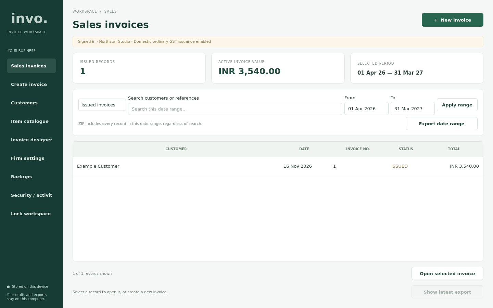
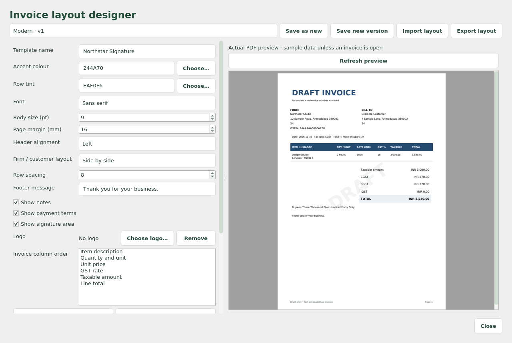

# Invoice Generator

An offline Windows desktop workspace for an Indian firm's sales invoices. The
frontend is PySide6; a separate Python application layer handles records,
calculations and documents; SQLite stores the workspace locally.

**Version 0.3: owner authentication, custom invoice layouts and a controlled
issuance workflow.** This is a testable application build, with the supported GST
scope described below. It is not a GST portal client or a complete accounting suite.



## Included

- First-run firm setup and owner sign-in, Argon2id password hashing, recovery codes,
  password changes, failed-login throttling, and a 15-minute inactivity lock.
- Persistent firm details, GSTIN, bank details, authorised signatory and invoice defaults.
- Customer and goods/services catalogues, with search, revision checks and deletion.
- Invoice editor with automatic Decimal totals, Indian amount-in-words, draft
  save/update/delete, unsaved-change protection, and actual PDF preview.
- A layout designer: logo, colours, fonts, margins, row spacing, header alignment,
  side-by-side/stacked parties, reorderable columns/sections, notes, terms and footer.
  Save named versions and import/export layout JSON files.
- Issued invoices receive simple numbers: **1, 2, 3…**. Each April–March financial
  year has its own counter; the displayed invoice number contains no year prefix.
  Number allocation, snapshot, audit and pending-render record commit together.
- Issued records retain the captured firm, item, tax and layout facts. They are
  read-only; cancellation keeps the original number and records the reason.
- PDF and editable Word exports. Date-range ZIP packages contain PDF/Word copies,
  invoice and line-item CSV registers and a manifest. Draft and issued exports are
  separate; cancelled records are labelled in issued registers.
- Password-encrypted complete workspace backups, checksum/integrity verification,
  and restore into a separate empty folder. Audit history is available in the UI.
- Five enforced dependency boundaries; backend operation does not import Qt.



## Start on Windows

Install 64-bit Python 3.12 and Git, then use PowerShell:

```powershell
git clone https://github.com/Skyvv4lk3r/Invoice_Maker_Software.git
cd Invoice_Maker_Software
git switch feat/firm-security-templates
py -3.12 -m venv .venv
.\.venv\Scripts\python.exe -m pip install --upgrade pip
.\.venv\Scripts\python.exe -m pip install -e ".[desktop,dev,gui-test]"
.\.venv\Scripts\python.exe -m invoice_generator
```

For an existing clone, fetch and switch to this feature branch, then repeat the
install command. Activation is optional; directly calling the environment's Python
avoids PowerShell activation-policy issues. The branch is a reviewable development
build; it has not been merged or published as a release.

A Windows portable build is also produced by the desktop GitHub Actions job. When
the job succeeds, download **InvoiceGenerator-Windows-portable** from its artifacts,
extract the complete folder and run `InvoiceGenerator.exe`. Keep `_internal` beside
the executable. These unsigned test builds are retained for 14 days. A signed
installer and automatic updates are still future work.

## First use

1. Create your owner account and save the one-time recovery code somewhere safe.
   No default password exists. Changing/resetting the password rotates the code.
2. Open **Firm settings**. Save the legal firm details, GSTIN, signatory, bank
   details and terms. Draft-only mode is the default.
3. Open **Invoice designer**. Customize a built-in layout and **Save as new**.
   Set it as the default in Firm settings. Existing issued invoices retain theirs.
4. Add customers and items to the catalogues, then create an invoice. Preview,
   save and export a draft, or finalize it after the issuance checks pass.
5. In **Sales invoices**, select Drafts or Issued invoices, apply start/end dates,
   and export the range. Search filters the screen, not the package. **Show latest
   export** opens the folder so you can share the files through your normal apps.
6. Create an encrypted backup under **Backups**. Restore always makes a separate
   copy; restart and use **Open another workspace folder** on the sign-in screen
   to open it. Sign in with the credentials contained in that backup.

The application does not send messages, upload records or file returns. CSV text
that could become a spreadsheet formula is escaped. Word copies are editable;
manual edits to a Word file do not update the stored invoice.

## Issuance scope and limitations

Issuance requires the owner to confirm the firm's applicability in settings.
**IRN-required mode and unreviewed mode block final issuance.** The implemented
workflow is domestic ordinary taxable INR sales using CGST+SGST or IGST. It checks
required details, GSTIN structure/checksum, supplier-state consistency, place of
supply versus tax split, HSN/SAC shape, positive tax rate and signatory. It does
not verify registration status, classification or rates against government data.

Unsupported: e-invoice/IRN generation, GST filing, reverse charge, SEZ, exports,
UTGST intraterritory supplies, cess, exempt/nil-rated supplies, credit/debit notes,
purchase invoices, payments ledger, discounts and opening-number import.
**Use this numbering series only for a new series beginning at 1 for each financial
year.** It does not import an existing firm's prior invoice numbers. Do not use a
restored old backup as a second issuing workspace: reconcile its counter with
records issued since the backup before resuming. There is no multi-device sync.

The operator must validate tax treatment with the accountant and sign documents
where required. A local cancellation is not a GST portal cancellation or a credit
note. The accountant ZIP is a register, not a portal-compatible return upload.

Calculation rounds each line's taxable amount and each tax component to paise
with `ROUND_HALF_UP`, then sums the displayed components. This policy is tested;
coverage of a policy is not a certification of every business's tax treatment.

## Data and security

On Windows the default folder is normally `%LOCALAPPDATA%\InvoiceGenerator`, with
`invoices.db` and `exports/`. Override it with `--data-dir PATH` or
`INVOICE_GENERATOR_DATA_DIR`. Alembic upgrades existing draft databases in place;
first startup then asks you to create the workspace owner.

Owner authentication controls application access. **The live database and exported
files are not encrypted.** Someone with filesystem access can read or modify them;
use an appropriate OS account and disk encryption. Backups use a separate
passphrase and authenticated encryption. Lost password plus lost recovery code
cannot be recovered through the app. See [security](SECURITY.md).

Backups are bounded to 128 MB of uncompressed records/exports and 9,999 stored
files. Exports run in memory and are intended for modest single-workstation data.
Larger installations need streaming export and a different concurrency design.

## Development and checks

```powershell
.\.venv\Scripts\python.exe scripts\check.py
$env:QT_QPA_PLATFORM = "offscreen"
.\.venv\Scripts\python.exe -m pytest tests\gui
.\.venv\Scripts\python.exe -m build
```

Build the portable application on Windows:

```powershell
.\.venv\Scripts\python.exe -m pip install -e ".[desktop,packaging]"
.\.venv\Scripts\python.exe scripts\build_desktop.py
```

GitHub Actions runs backend checks on Windows/Linux with Python 3.12/3.13 and GUI
checks plus packaging on Windows. For a disposable backend demonstration, use
`python -m invoice_generator --demo --data-dir PATH_TO_NEW_EMPTY_FOLDER`; it creates
a fictional draft under a random demo account and rejects configured workspaces.

| Path | Responsibility |
| --- | --- |
| `presentation/` | Qt screens, form values and worker bridge |
| `application/contracts/` | Immutable values and narrow public Protocols |
| `application/handlers/` | Authentication and invoice/workspace use cases |
| `application/ports/` | Persistence, rendering, identity and asset interfaces |
| `domain/` | Money calculations, GST checks and fiscal-year rules |
| `infrastructure/` | SQLite/Alembic, documents, hashing, images and backups |
| `bootstrap.py` | Concrete adapter construction and dependency injection |

These paths sit under `src/invoice_generator`. UI styling is separate from invoice
layout settings. Read [architecture](docs/ARCHITECTURE.md),
[templates](docs/TEMPLATES.md), [roadmap](docs/ROADMAP.md),
[validation](docs/VALIDATION.md) and [contributing](CONTRIBUTING.md).
The original [UML specification](docs/design/UML_System_Design.pdf) remains the
broader target design; the architecture document identifies what this build implements.
No open-source licence has been selected.
