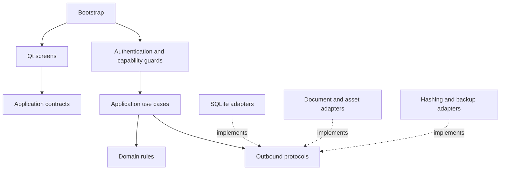
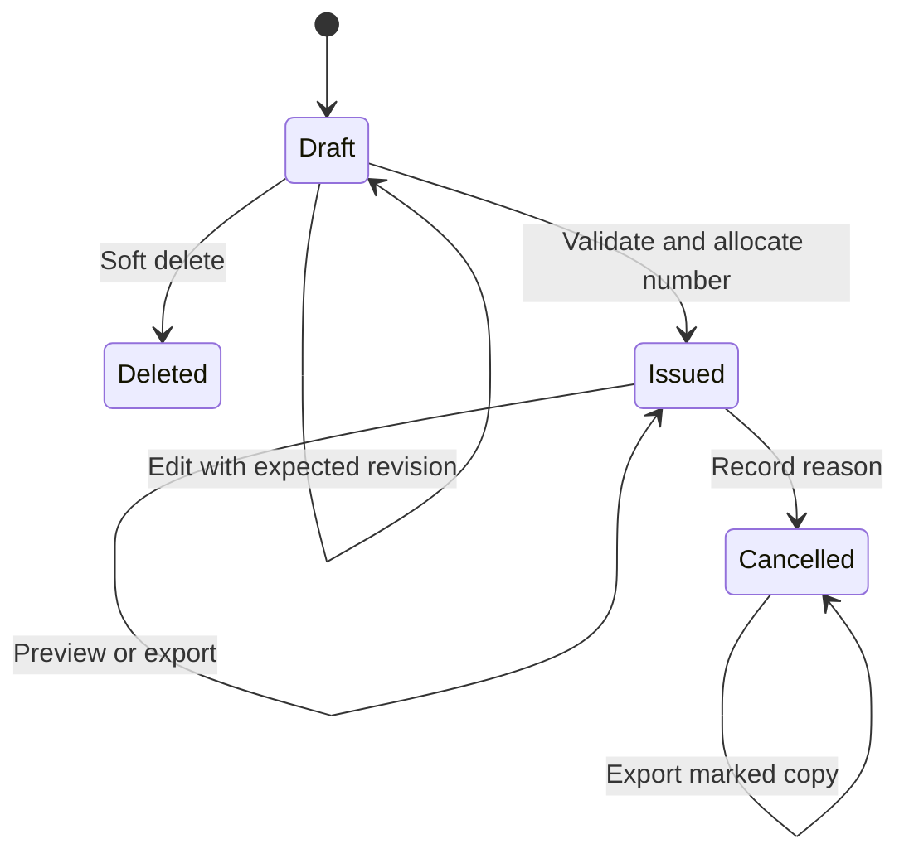

# Architecture as implemented in version 0.3

One local desktop process has independently testable frontend and backend packages.
Presentation imports only public application contracts, its own modules, Qt and the
standard library. It never imports database, tax, cryptography or rendering libraries.
The application core is usable without Qt. Five import-linter contracts enforce this.

Arrows show dependencies or wiring, not all runtime calls. Bootstrap injects
separate capabilities, rather than providing a global manager or service locator.

| Responsibility | Implementation |
| --- | --- |
| Screen and worker state | Qt widgets, frozen requests and queued results; no widget access from workers |
| Business calculations | Decimal/string inputs, integer paise, domain validation |
| Access control | Owner identity, ephemeral session, persisted epoch/throttle, capability decorators |
| Data transactions | Fresh SQLAlchemy session per operation; optimistic draft/catalog revisions |
| Document preparation | Neutral immutable model with stored amounts; renderers do not calculate tax |
| Template settings | Immutable versions with normalized PNG bytes; no scripts or arbitrary HTML |
| Final issuance | SQLite write transaction, fiscal counter, snapshot, audit, pending render record |
| Backup | SQLite consistent backup, authenticated encrypted archive, verified staged restore |

## Authentication boundary

Every data/document/catalog/backup capability constructed by bootstrap is guarded
by AuthenticationService. Hiding screens is not the access-control mechanism.
An owner is created once. Password and recovery code are Argon2id hashes. Each
session records the current credential epoch and an activity deadline. Credential
rotation increments the persisted epoch so other running sessions become invalid.
Five failed attempts cause a persisted five-minute lockout. Sign-in is process-local;
there are no reusable access tokens stored on disk.

This is application access control, not a hostile-filesystem security boundary.
The owner of the OS account can inspect the unencrypted database. The Python
backend is an internal interface, not an exposed web API. Future HTTP exposure
requires additional input validation, transport/session security and deployment work.

## Draft and issuance lifecycle

Draft save and audit commit together. Issued drafts cannot be edited or deleted.
Issuance validates an ordinary domestic taxable supply and the firm's explicit
applicability setting. Under `BEGIN IMMEDIATE`, it rechecks the expected draft and
firm revisions, allocates the next integer for the invoice date's April–March
financial year, captures the document facts and layout, appends audit history and
creates a PENDING render record in one transaction. A unique constraint covers
financial year plus number. Draft ID and request ID also have uniqueness constraints.
Retrying the same issue request returns the same invoice. Cancellation retains the
number; a later invoice cannot reuse it. Changing the workspace GSTIN after issuance
is rejected. Additional firm registrations need separate workspaces.

Rendering happens after commit. Failure leaves the number and snapshot intact;
export can be retried from the stored document. Successful PDF export marks its
render record READY, guarded against a concurrent cancellation. There is no
background job runner or automatic retry scheduler yet. Old exported copies can
still exist after cancellation; the application cannot revoke shared files.

## Templates and output

Drafts select the latest saved version of their template. Issuance captures the
full layout and normalized logo, firm/customer information and calculated amounts.
Later template/catalog/profile changes do not alter those captured facts.
Renderer code/fonts are not version-pinned per invoice; upgrades may change
pagination when regenerating a document. Keep original exported PDFs for exact
historical bytes. Completed export files are included in backups.

PDF and Word share the document model and ordered layout settings; their pagination
may differ. ZIP exports read the records in one database query and render the same
captured snapshots into documents, CSV registers and a manifest. Publication uses
unique temporary files and atomic replacement. Exports are memory-bound; streaming
and progress/cancellation are later work.

## SOLID decisions

| Principle | Concrete boundary |
| --- | --- |
| Single responsibility | Identity, firm profile, catalogue, issuance, backup and rendering use cases are separate |
| Open/closed | Inject another renderer/storage adapter through the existing capability |
| Liskov substitution | Adapter tests check result, money, transaction and failure semantics |
| Interface segregation | Separate authentication, template, firm, catalogue, issue, preview and file-action Protocols |
| Dependency inversion | Application-owned contracts/ports are implemented by infrastructure; only bootstrap chooses concrete adapters |

## Storage and migration

`0001` stores drafts/audit; `0002_workspace` adds identity, firm/catalogue records and
template versions; `0003_issuance` adds counters, snapshots and render status.
Existing draft JSON remains readable using backward-compatible defaults. No
migration replaces a user's database. New identity/issued tables explicitly reject
destructive downgrades. Backup restore only accepts this schema version, verifies
hashes and SQLite integrity, and stages a new directory. Live database sharing over
network/cloud folders is unsupported.

The original 41-page UML includes broader abstractions such as published template
bundles, persistent export jobs, payment ledgers, credit/debit notes and purchase
capture. Those remain targets; this document describes the working implementation.
